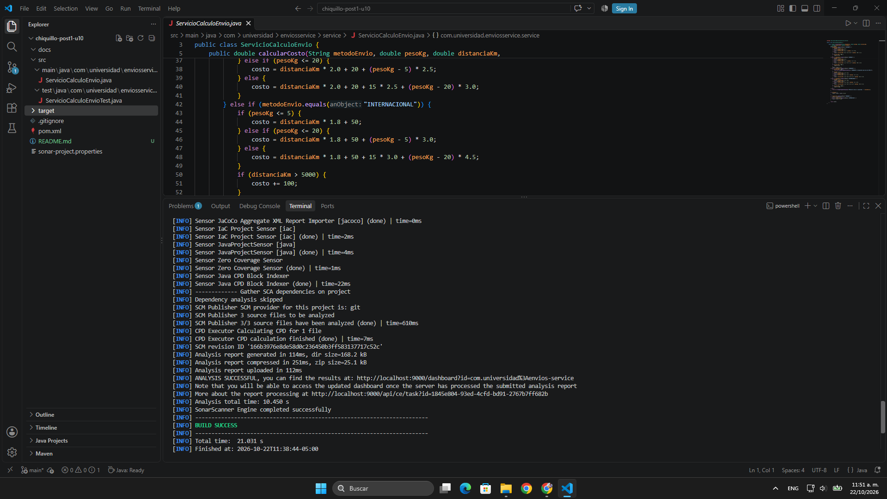
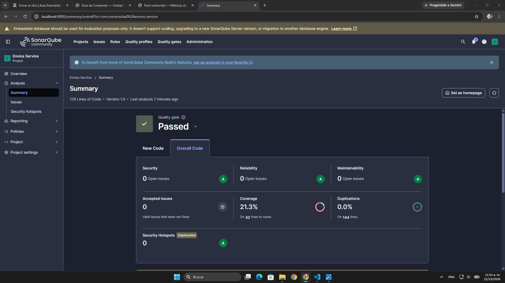
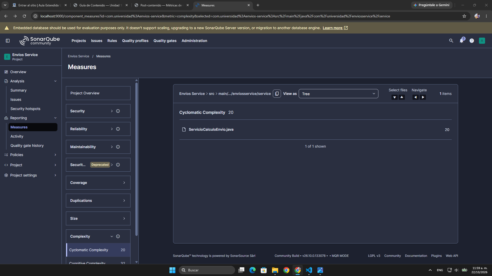
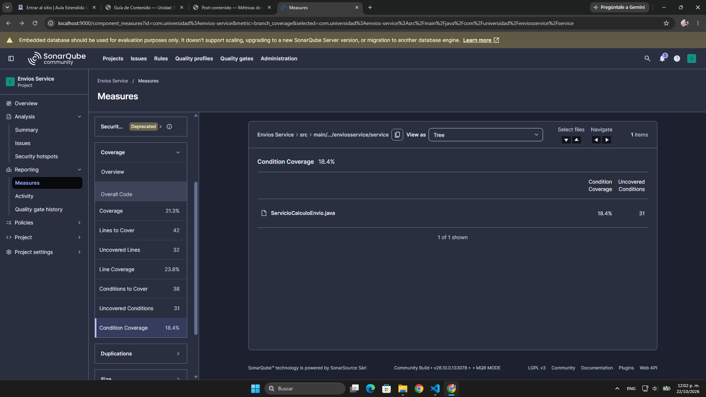
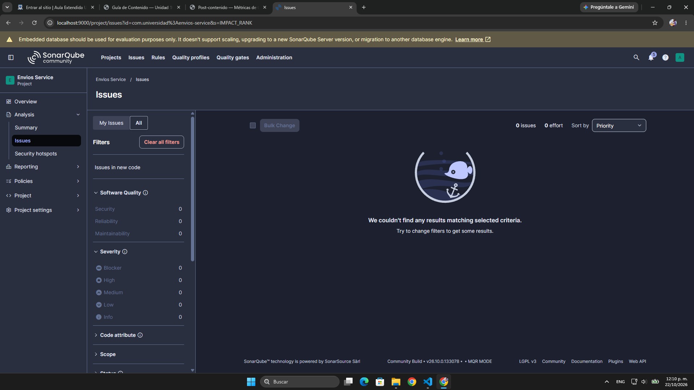
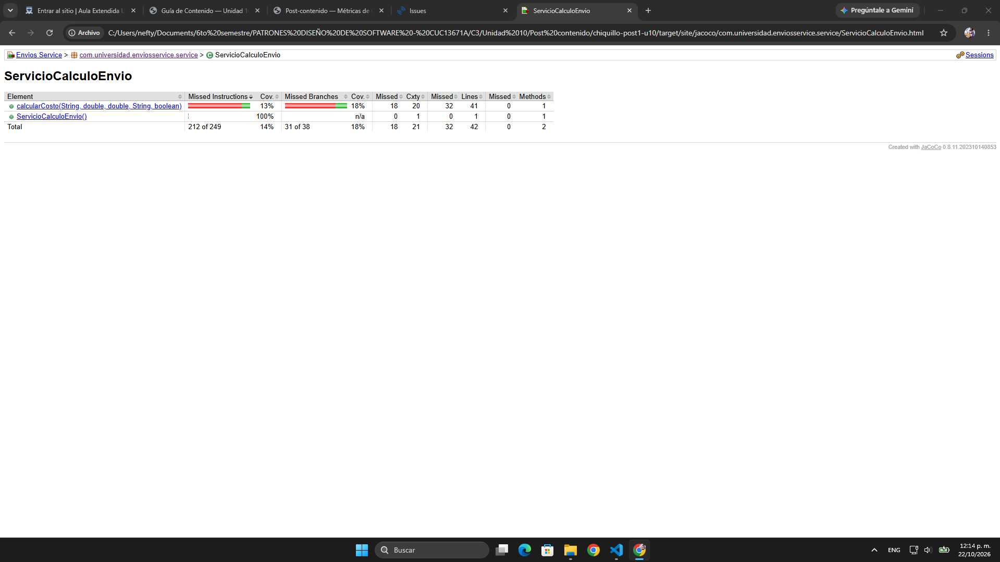
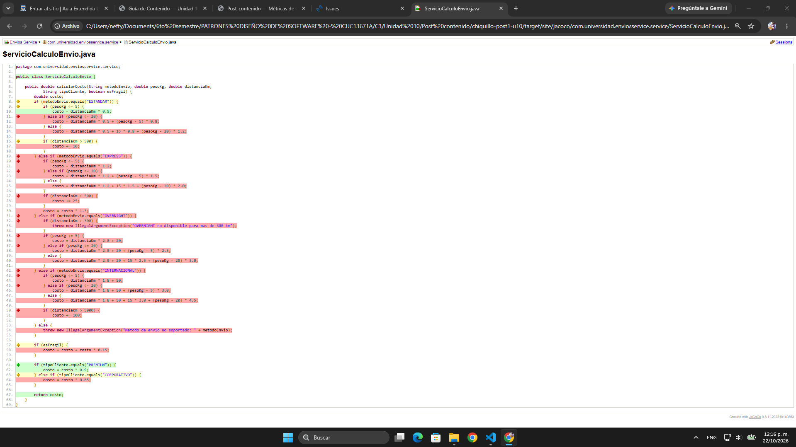

# Envios Service — Análisis de Métricas de Calidad

## Descripción

Repositorio del post-contenido de la Unidad 10 de Patrones de Diseño de Software. Contiene un proyecto Maven plano (`envios-service`, sin Spring Boot) que calcula el costo de un envío según el método de transporte, el peso, la distancia, la fragilidad del paquete y el tipo de cliente.

Toda la lógica está a propósito en un solo método, `ServicioCalculoEnvio.calcularCosto()`, con una cadena larga de condicionales, y la suite de pruebas de partida solo tiene dos casos. En la **Parte 1** se configuran SonarQube y JaCoCo, se ejecuta el primer análisis y se interpretan los resultados reales para encontrar qué método concentra el problema y por qué.

```text
chiquillo-post1-u10/
├── pom.xml                      ← JaCoCo, scanner de SonarQube y propiedades sonar.*
├── sonar-project.properties     ← configuración del análisis (comentada)
├── docs/                        ← capturas del análisis
└── src/
    ├── main/java/com/universidad/enviosservice/service/
    │   └── ServicioCalculoEnvio.java      ← método con complejidad ciclomática alta
    └── test/java/com/universidad/enviosservice/service/
        └── ServicioCalculoEnvioTest.java  ← suite inicial (2 pruebas)
```

## Cómo ejecutar

Requisitos: JDK 21, Maven 3.9+ y Docker Desktop.

```powershell
# 1. Levantar SonarQube (esperar "SonarQube is operational" en los logs)
docker run -d --name sonarqube -p 9000:9000 -e SONAR_ES_BOOTSTRAP_CHECKS_DISABLE=true sonarqube:community

# 2. Compilar, correr las pruebas y generar el reporte JaCoCo
mvn clean verify

# 3. Analizar con SonarQube (el scanner lee el token de la variable SONAR_TOKEN)
$env:SONAR_TOKEN = "token_generado_en_sonarqube"
mvn sonar:sonar
```

- Dashboard: `http://localhost:9000` → proyecto **Envios Service** (key `com.universidad:envios-service`)
- Reporte JaCoCo: `target/site/jacoco/index.html`

## Decisiones de diseño

1. **Entorno de análisis:** SonarQube local con Docker, por el control total de la configuración (Quality Profile y Quality Gate propios) y por no depender de conectividad ni de un plan gratuito. Detalle en *Entorno de análisis*.
2. **Exclusiones del análisis:** no se excluye nada, porque la única clase de `src/main/java` es la lógica de negocio que se quiere medir. Detalle en *Exclusiones del análisis*.
3. **Métrica usada como señal principal:** complejidad ciclomática, porque es la que la Parte 2 tiene que reducir y explica cuántas pruebas faltan. La cognitiva queda como señal de apoyo. Detalle en *Interpretación*.

---

## Entorno de análisis

**Decisión de diseño 1:** SonarQube **local con Docker** (imagen `sonarqube:community`, que corresponde a SonarQube Community Build v26.10). **Alternativa descartada:** SonarCloud.

**Justificación:**

1. **Control total de la configuración.** En la Parte 2 hay que duplicar el perfil "Sonar Way", activar la regla de complejidad por método con umbral 10 y crear un Quality Gate propio con tres condiciones. En el servidor local soy administradora, así que puedo hacer todo eso sin depender de lo que permita un plan gratuito.
2. **No depende de conectividad ni de cuentas externas.** El análisis corre contra `http://localhost:9000`, y no necesito vincular el repositorio de GitHub ni que el proyecto quede público en otra plataforma mientras está a medias.
3. **Evidencia reproducible.** Cualquiera que clone el repo puede levantar el mismo servidor con un solo `docker run` y repetir el análisis con los mismos pasos del README.

**Lo que cuesta esta elección:** el contenedor consume recursos de mi equipo (unos 2,6 GB de RAM según `docker stats`) y hay que dejarlo corriendo durante todo el laboratorio, porque si se borra el contenedor se pierde el historial de análisis y no podría comparar el antes y el después. Además, la imagen usa la base de datos embebida (SonarQube muestra el aviso *"Embedded database should be used for evaluation purposes only"*). Para un laboratorio es suficiente, pero en un equipo real se usaría PostgreSQL. Con SonarCloud me ahorraría la instalación y el dashboard quedaría accesible desde cualquier equipo, pero para este caso pesa más tener el control de la configuración.

## Exclusiones del análisis

**Decisión de diseño 2:** **no se excluye ninguna clase** del análisis.

**Justificación:**

1. El proyecto solo tiene una clase en `src/main/java`, `ServicioCalculoEnvio`, y es justo la lógica de negocio que se quiere medir. No hay clase `Main`, DTOs, configuración ni código generado que pudiera bajar el porcentaje de cobertura sin decir nada sobre la calidad del negocio, que es el caso en el que la guía (sección 2.3) recomienda excluir.
2. Excluir algo aquí solo escondería información: si se excluyera la única clase, el análisis quedaría vacío.
3. Las pruebas no necesitan exclusión, porque el scanner las identifica como código de prueba (`src/test/java`) y no las cuenta dentro de la cobertura.

**Detalle de configuración:** el análisis se ejecuta con `mvn sonar:sonar`, y el scanner de Maven **no lee** `sonar-project.properties`, porque ese archivo es para el scanner de línea de comandos (`sonar-scanner`). Por eso las mismas propiedades (`sonar.projectKey`, `sonar.projectName`, `sonar.host.url`, `sonar.coverage.jacoco.xmlReportPaths`) también están en las `<properties>` del `pom.xml`. Si en el futuro se agregara una clase de arranque, el `sonar.exclusions` tendría que ir en el `pom.xml` para que tenga efecto con Maven. Dejarlo solo en `sonar-project.properties` no excluiría nada.

---

## Estado inicial del análisis

Primer análisis del 22/10/2026 (SonarQube Community Build v26.10, perfil y Quality Gate "Sonar way" por defecto, JaCoCo 0.8.11):

| Métrica | Valor real observado |
|---------|----------------------|
| Complejidad ciclomática de calcularCosto() | **20** |
| Cobertura de líneas de ServicioCalculoEnvio | **23,8%** (10 de 42 líneas) |
| Cobertura de ramas de ServicioCalculoEnvio | **18,4%** (7 de 38 condiciones; 31 sin cubrir) |
| Code Smells reportados | **0** (Maintainability: 0 open issues, rating A) |

Otros valores del mismo análisis que se usan en la interpretación:

| Métrica | Valor |
|---------|-------|
| Complejidad cognitiva | 32 |
| Coverage (líneas + ramas combinadas, como lo calcula SonarQube) | 21,3% |
| Duplicaciones | 0,0% |
| Líneas de código | 128 |
| Quality Gate (Sonar way) | Passed |

## Interpretación

**¿Qué método concentra el problema?** `calcularCosto()`. SonarQube muestra la complejidad por archivo (`ServicioCalculoEnvio.java` = 20), y el valor por método lo confirma el reporte de JaCoCo en la columna *Cxty*: `calcularCosto` tiene 20 y el constructor 1. El 20 coincide con la fórmula de la guía (CC = 1 + puntos de decisión): 4 `if`/`else if` de método de envío, 2 de tramos de peso en cada uno de los 4 métodos (8), 3 recargos por distancia (ESTANDAR, EXPRESS, INTERNACIONAL), 1 restricción de distancia en OVERNIGHT, 1 de fragilidad y 2 de tipo de cliente: 19 puntos de decisión + 1 = **20**. Según la Tabla 3.2 de la guía queda en el rango **"Alta" (11–20)**, justo en el límite con "Muy alta".

**¿Qué ramas quedaron sin cubrir?** Las dos pruebas iniciales usan el mismo escenario (ESTANDAR, 3 kg, 100 km, no frágil) y solo cambian el tipo de cliente. En el reporte de JaCoCo se ve que:

- En **ESTANDAR** solo se ejecuta el tramo `pesoKg <= 5`. Los tramos de 5–20 kg y más de 20 kg y el recargo por más de 500 km quedan en rojo o amarillo.
- **EXPRESS, OVERNIGHT e INTERNACIONAL** quedan completamente en rojo: ninguna prueba entra a esas ramas, así que tampoco se prueban la restricción de OVERNIGHT a más de 300 km, el recargo internacional por más de 5000 km ni el multiplicador 1,3 de EXPRESS.
- El `else` de **método no soportado** (que lanza `IllegalArgumentException`) nunca se ejecuta.
- **Fragilidad** solo se evalúa en `false` (el recargo del 15% nunca se aplica), y **CORPORATIVO** solo en `false` (el descuento del 15% nunca se aplica). El único `if` cubierto en sus dos lados es el de PREMIUM.

En total son 7 de 38 ramas (18,4%), y la cobertura de líneas sale un poco más alta (23,8%) porque una línea se cuenta cubierta aunque solo se haya ejecutado uno de los lados de su condición. Por eso la cobertura de ramas es la métrica más honesta aquí.

**¿Por qué coinciden la complejidad alta y la cobertura baja?** Porque todo está en el mismo método: la clase no tiene otro método con lógica, así que los 19 puntos de decisión y las 31 ramas sin cubrir caen en `calcularCosto()`. Además, una cosa explica la otra: según la sección 3.3 de la guía, un método con CC = 20 necesita al menos 20 casos de prueba para cubrir todas sus ramas, y la suite solo tiene 2, que además recorren casi el mismo camino.

**Lo que no esperaba: 0 code smells y Quality Gate "Passed".** La guía (sección 3.3) dice que Sonar Way señala como code smell los métodos con CC > 10, pero con la configuración por defecto de esta versión el análisis no reportó **ningún** issue para un método con CC = 20 y complejidad cognitiva 32. El Quality Gate también pasó, porque "Sonar way" solo evalúa condiciones sobre *código nuevo*, y en el primer análisis no hay código nuevo contra el cual comparar. Esto muestra dos cosas: las métricas sí detectan el problema aunque las reglas activas no lo conviertan en issue, y un "Passed" en el primer análisis no significa que el código esté bien. Por eso en la Parte 2 hay que crear un Quality Profile con la regla de complejidad por método activada y un Quality Gate propio, en lugar de confiar en los valores por defecto.

### Decisión de diseño 3 — Métrica usada como señal principal

**Decisión:** la **complejidad ciclomática** es la señal principal para elegir el método a intervenir. **Alternativas descartadas como señal principal:** complejidad cognitiva y cobertura.

**Justificación:**

1. **Mide justo lo que la Parte 2 tiene que bajar.** El objetivo de la refactorización es reducir la complejidad ciclomática con un patrón (Strategy, State o Chain of Responsibility), y la comparación antes/después del post se hace con esa métrica. Usarla como señal deja el diagnóstico y la meta medidos con lo mismo.
2. **Conecta la estructura del método con las pruebas que faltan.** CC = 20 dice cuántos caminos independientes tiene el método y, por lo tanto, el mínimo de pruebas necesarias. Con ella se explica directamente por qué la cobertura de ramas es tan baja.
3. **La cobertura sola no sirve para decidir qué refactorizar.** Una cobertura baja se arregla escribiendo pruebas, no cambiando el diseño. Si solo se mirara la cobertura, la conclusión sería "faltan pruebas", pero no "este método tiene demasiadas responsabilidades".

**Sobre la complejidad cognitiva (32):** también apunta a `calcularCosto()`, y es más alta porque castiga el anidamiento (los `if` de peso están dentro de los `if` de método de envío). Es una buena señal de qué tan difícil es leer el método, pero no se traduce en un número mínimo de pruebas, y el patrón que se aplique en la Parte 2 va a atacar justamente la cadena de condicionales que cuenta la ciclomática. La dejo como **señal de apoyo**: si después del refactor también baja, confirma que el método quedó más fácil de leer y no solo con menos caminos.

**Sobre los code smells (0):** no podían ser la señal, porque como se vio arriba las reglas por defecto no generaron ningún issue. Si me hubiera guiado por el conteo de issues, la conclusión habría sido que no había nada que corregir.

## Capturas del análisis inicial

**Análisis ejecutado** — `mvn clean verify sonar:sonar` con `ANALYSIS SUCCESSFUL` y `BUILD SUCCESS`:



**Dashboard de SonarQube** — Coverage 21,3%, 0 issues y Quality Gate Passed:



**Measures → Complexity** — Cyclomatic Complexity 20 en `ServicioCalculoEnvio.java` (Cognitive Complexity 32):



**Measures → Coverage** — Condition Coverage 18,4%, 31 condiciones sin cubrir, Line Coverage 23,8%:



**Issues** — 0 issues con el perfil por defecto:



**Reporte JaCoCo por método** — `calcularCosto`: Cxty 20, 31 de 38 ramas sin cubrir:



**Reporte JaCoCo del código fuente** — en rojo y amarillo las ramas que la suite inicial no ejercita:



## Herramientas utilizadas

- Java 21, Apache Maven 3.9
- SonarQube Community Build (Docker), JaCoCo 0.8.11
- Git, GitHub

## Conclusiones

El diagnóstico dejó claro que el problema está concentrado en `calcularCosto()`, con complejidad ciclomática 20 y solo 7 de 38 ramas cubiertas, y que la cobertura de ramas refleja mejor ese vacío que la de líneas. Además, con la configuración por defecto SonarQube no reportó ningún code smell y el Quality Gate salió "Passed", lo que muestra que hay que leer las métricas y no solo el conteo de issues, y que las reglas y el Quality Gate deben configurarse según lo que se quiere controlar.
