# Envios Service — Diagnóstico y Mejora Guiada por Métricas

## Descripción

Repositorio del post-contenido de la Unidad 10 de Patrones de Diseño de Software. Contiene un proyecto Maven plano (`envios-service`, sin Spring Boot) que calcula el costo de un envío según el método de transporte, el peso, la distancia, la fragilidad del paquete y el tipo de cliente.

Toda la lógica está a propósito en un solo método, `ServicioCalculoEnvio.calcularCosto()`, con una cadena larga de condicionales, y la suite de pruebas de partida solo tiene dos casos. En la **Parte 1** se configuran SonarQube y JaCoCo, se ejecuta el primer análisis y se interpretan los resultados reales para encontrar qué método concentra el problema y por qué. En la **Parte 2** se aplica el patrón Strategy para reducir la complejidad de ese método, se agregan las pruebas que faltaban, se configura un Quality Profile y un Quality Gate propios y se compara el análisis antes y después.

```text
chiquillo-post1-u10/
├── pom.xml                      ← JaCoCo, scanner de SonarQube y propiedades sonar.*
├── sonar-project.properties     ← configuración del análisis (comentada)
├── docs/                        ← capturas de ambos análisis
└── src/
    ├── main/java/com/universidad/enviosservice/
    │   ├── service/
    │   │   └── ServicioCalculoEnvio.java      ← orquestador (antes: método con CC 20)
    │   └── estrategia/
    │       ├── EstrategiaEnvio.java           ← interfaz Strategy
    │       ├── EnvioEstandarStrategy.java
    │       ├── EnvioExpressStrategy.java
    │       ├── EnvioOvernightStrategy.java
    │       ├── EnvioInternacionalStrategy.java
    │       └── TramosDePeso.java              ← cargo por peso compartido
    └── test/java/com/universidad/enviosservice/
        ├── service/
        │   └── ServicioCalculoEnvioTest.java  ← 2 pruebas iniciales + 6 nuevas
        └── estrategia/
            └── Envio*StrategyTest.java        ← una clase de prueba por estrategia
```

## Cómo ejecutar

Requisitos: JDK 21, Maven 3.9+ y Docker Desktop.

```powershell
# 1. Levantar SonarQube (esperar "SonarQube is operational" en los logs)
docker run -d --name sonarqube -p 9000:9000 -e SONAR_ES_BOOTSTRAP_CHECKS_DISABLE=true sonarqube:community

# 2. Compilar, correr las pruebas y generar el reporte JaCoCo
mvn clean verify

# 3. Analizar con SonarQube (el scanner lee el token de la variable SONAR_TOKEN)
$env:SONAR_TOKEN = "token_generado_en_sonarqube"
mvn sonar:sonar
```

- Dashboard: `http://localhost:9000` → proyecto **Envios Service** (key `com.universidad:envios-service`)
- Reporte JaCoCo: `target/site/jacoco/index.html`

## Decisiones de diseño

1. **Entorno de análisis:** SonarQube local con Docker, por el control total de la configuración (Quality Profile y Quality Gate propios) y por no depender de conectividad ni de un plan gratuito. Detalle en *Entorno de análisis*.
2. **Exclusiones del análisis:** no se excluye nada, porque la única clase de `src/main/java` es la lógica de negocio que se quiere medir. Detalle en *Exclusiones del análisis*.
3. **Métrica usada como señal principal:** complejidad ciclomática, porque es la que la Parte 2 tiene que reducir y explica cuántas pruebas faltan. La cognitiva queda como señal de apoyo. Detalle en *Interpretación*.
4. **Patrón elegido:** Strategy, porque cada rama de `metodoEnvio` calcula el mismo tipo de resultado con una fórmula propia, elegida una sola vez por un valor de entrada. El método no guarda estado (descarta State) y sus ramas son excluyentes, así que el orden no importa (descarta Chain of Responsibility). Detalle en *Elección del patrón*.
5. **Criterio de pruebas agregadas:** cada prueba nueva apunta a una rama que el reporte JaCoCo de la Parte 1 dejó en rojo o amarillo, o a un valor límite de peso o distancia, y verifica un valor calculado a mano. No se agregaron pruebas que repitan un camino ya cubierto. Detalle en *Pruebas agregadas*.
6. **Realismo del Quality Gate:** CC = 10 por método porque es el techo del rango "Moderada" de la Tabla 3.2, y Coverage = 70% porque exigir 100% empuja a escribir pruebas vacías. Detalle en *Quality Profile y Quality Gate*.

---

## Entorno de análisis

**Decisión de diseño 1:** SonarQube **local con Docker** (imagen `sonarqube:community`, que corresponde a SonarQube Community Build v26.10). **Alternativa descartada:** SonarCloud.

**Justificación:**

1. **Control total de la configuración.** En la Parte 2 hay que duplicar el perfil "Sonar Way", activar la regla de complejidad por método con umbral 10 y crear un Quality Gate propio con tres condiciones. En el servidor local soy administradora, así que puedo hacer todo eso sin depender de lo que permita un plan gratuito.
2. **No depende de conectividad ni de cuentas externas.** El análisis corre contra `http://localhost:9000`, y no necesito vincular el repositorio de GitHub ni que el proyecto quede público en otra plataforma mientras está a medias.
3. **Evidencia reproducible.** Cualquiera que clone el repo puede levantar el mismo servidor con un solo `docker run` y repetir el análisis con los mismos pasos del README.

**Lo que cuesta esta elección:** el contenedor consume recursos de mi equipo (unos 2,6 GB de RAM según `docker stats`) y hay que dejarlo corriendo durante todo el laboratorio, porque si se borra el contenedor se pierde el historial de análisis y no podría comparar el antes y el después. Además, la imagen usa la base de datos embebida (SonarQube muestra el aviso *"Embedded database should be used for evaluation purposes only"*). Para un laboratorio es suficiente, pero en un equipo real se usaría PostgreSQL. Con SonarCloud me ahorraría la instalación y el dashboard quedaría accesible desde cualquier equipo, pero para este caso pesa más tener el control de la configuración.

## Exclusiones del análisis

**Decisión de diseño 2:** **no se excluye ninguna clase** del análisis.

**Justificación:**

1. El proyecto solo tiene una clase en `src/main/java`, `ServicioCalculoEnvio`, y es justo la lógica de negocio que se quiere medir. No hay clase `Main`, DTOs, configuración ni código generado que pudiera bajar el porcentaje de cobertura sin decir nada sobre la calidad del negocio, que es el caso en el que la guía (sección 2.3) recomienda excluir.
2. Excluir algo aquí solo escondería información: si se excluyera la única clase, el análisis quedaría vacío.
3. Las pruebas no necesitan exclusión, porque el scanner las identifica como código de prueba (`src/test/java`) y no las cuenta dentro de la cobertura.

**Detalle de configuración:** el análisis se ejecuta con `mvn sonar:sonar`, y el scanner de Maven **no lee** `sonar-project.properties`, porque ese archivo es para el scanner de línea de comandos (`sonar-scanner`). Por eso las mismas propiedades (`sonar.projectKey`, `sonar.projectName`, `sonar.host.url`, `sonar.coverage.jacoco.xmlReportPaths`) también están en las `<properties>` del `pom.xml`. Si en el futuro se agregara una clase de arranque, el `sonar.exclusions` tendría que ir en el `pom.xml` para que tenga efecto con Maven. Dejarlo solo en `sonar-project.properties` no excluiría nada.

---

## Estado inicial del análisis

Primer análisis del 22/10/2026 (SonarQube Community Build v26.10, perfil y Quality Gate "Sonar way" por defecto, JaCoCo 0.8.11):

| Métrica | Valor real observado |
|---------|----------------------|
| Complejidad ciclomática de calcularCosto() | **20** |
| Cobertura de líneas de ServicioCalculoEnvio | **23,8%** (10 de 42 líneas) |
| Cobertura de ramas de ServicioCalculoEnvio | **18,4%** (7 de 38 condiciones; 31 sin cubrir) |
| Code Smells reportados | **0** (Maintainability: 0 open issues, rating A) |

Otros valores del mismo análisis que se usan en la interpretación:

| Métrica | Valor |
|---------|-------|
| Complejidad cognitiva | 32 |
| Coverage (líneas + ramas combinadas, como lo calcula SonarQube) | 21,3% |
| Duplicaciones | 0,0% |
| Líneas de código | 128 |
| Quality Gate (Sonar way) | Passed |

## Interpretación

**¿Qué método concentra el problema?** `calcularCosto()`. SonarQube muestra la complejidad por archivo (`ServicioCalculoEnvio.java` = 20), y el valor por método lo confirma el reporte de JaCoCo en la columna *Cxty*: `calcularCosto` tiene 20 y el constructor 1. El 20 coincide con la fórmula de la guía (CC = 1 + puntos de decisión): 4 `if`/`else if` de método de envío, 2 de tramos de peso en cada uno de los 4 métodos (8), 3 recargos por distancia (ESTANDAR, EXPRESS, INTERNACIONAL), 1 restricción de distancia en OVERNIGHT, 1 de fragilidad y 2 de tipo de cliente: 19 puntos de decisión + 1 = **20**. Según la Tabla 3.2 de la guía queda en el rango **"Alta" (11–20)**, justo en el límite con "Muy alta".

**¿Qué ramas quedaron sin cubrir?** Las dos pruebas iniciales usan el mismo escenario (ESTANDAR, 3 kg, 100 km, no frágil) y solo cambian el tipo de cliente. En el reporte de JaCoCo se ve que:

- En **ESTANDAR** solo se ejecuta el tramo `pesoKg <= 5`. Los tramos de 5–20 kg y más de 20 kg y el recargo por más de 500 km quedan en rojo o amarillo.
- **EXPRESS, OVERNIGHT e INTERNACIONAL** quedan completamente en rojo: ninguna prueba entra a esas ramas, así que tampoco se prueban la restricción de OVERNIGHT a más de 300 km, el recargo internacional por más de 5000 km ni el multiplicador 1,3 de EXPRESS.
- El `else` de **método no soportado** (que lanza `IllegalArgumentException`) nunca se ejecuta.
- **Fragilidad** solo se evalúa en `false` (el recargo del 15% nunca se aplica), y **CORPORATIVO** solo en `false` (el descuento del 15% nunca se aplica). El único `if` cubierto en sus dos lados es el de PREMIUM.

En total son 7 de 38 ramas (18,4%), y la cobertura de líneas sale un poco más alta (23,8%) porque una línea se cuenta cubierta aunque solo se haya ejecutado uno de los lados de su condición. Por eso la cobertura de ramas es la métrica más honesta aquí.

**¿Por qué coinciden la complejidad alta y la cobertura baja?** Porque todo está en el mismo método: la clase no tiene otro método con lógica, así que los 19 puntos de decisión y las 31 ramas sin cubrir caen en `calcularCosto()`. Además, una cosa explica la otra: según la sección 3.3 de la guía, un método con CC = 20 necesita al menos 20 casos de prueba para cubrir todas sus ramas, y la suite solo tiene 2, que además recorren casi el mismo camino.

**Lo que no esperaba: 0 code smells y Quality Gate "Passed".** La guía (sección 3.3) dice que Sonar Way señala como code smell los métodos con CC > 10, pero con la configuración por defecto de esta versión el análisis no reportó **ningún** issue para un método con CC = 20 y complejidad cognitiva 32. El Quality Gate también pasó, porque "Sonar way" solo evalúa condiciones sobre *código nuevo*, y en el primer análisis no hay código nuevo contra el cual comparar. Esto muestra dos cosas: las métricas sí detectan el problema aunque las reglas activas no lo conviertan en issue, y un "Passed" en el primer análisis no significa que el código esté bien. Por eso en la Parte 2 hay que crear un Quality Profile con la regla de complejidad por método activada y un Quality Gate propio, en lugar de confiar en los valores por defecto.

### Decisión de diseño 3 — Métrica usada como señal principal

**Decisión:** la **complejidad ciclomática** es la señal principal para elegir el método a intervenir. **Alternativas descartadas como señal principal:** complejidad cognitiva y cobertura.

**Justificación:**

1. **Mide justo lo que la Parte 2 tiene que bajar.** El objetivo de la refactorización es reducir la complejidad ciclomática con un patrón (Strategy, State o Chain of Responsibility), y la comparación antes/después del post se hace con esa métrica. Usarla como señal deja el diagnóstico y la meta medidos con lo mismo.
2. **Conecta la estructura del método con las pruebas que faltan.** CC = 20 dice cuántos caminos independientes tiene el método y, por lo tanto, el mínimo de pruebas necesarias. Con ella se explica directamente por qué la cobertura de ramas es tan baja.
3. **La cobertura sola no sirve para decidir qué refactorizar.** Una cobertura baja se arregla escribiendo pruebas, no cambiando el diseño. Si solo se mirara la cobertura, la conclusión sería "faltan pruebas", pero no "este método tiene demasiadas responsabilidades".

**Sobre la complejidad cognitiva (32):** también apunta a `calcularCosto()`, y es más alta porque castiga el anidamiento (los `if` de peso están dentro de los `if` de método de envío). Es una buena señal de qué tan difícil es leer el método, pero no se traduce en un número mínimo de pruebas, y el patrón que se aplique en la Parte 2 va a atacar justamente la cadena de condicionales que cuenta la ciclomática. La dejo como **señal de apoyo**: si después del refactor también baja, confirma que el método quedó más fácil de leer y no solo con menos caminos.

**Sobre los code smells (0):** no podían ser la señal, porque como se vio arriba las reglas por defecto no generaron ningún issue. Si me hubiera guiado por el conteo de issues, la conclusión habría sido que no había nada que corregir.

## Capturas del análisis inicial

**Análisis ejecutado** — `mvn clean verify sonar:sonar` con `ANALYSIS SUCCESSFUL` y `BUILD SUCCESS`:


**Dashboard de SonarQube** — Coverage 21,3%, 0 issues y Quality Gate Passed:


**Measures → Complexity** — Cyclomatic Complexity 20 en `ServicioCalculoEnvio.java` (Cognitive Complexity 32):


**Measures → Coverage** — Condition Coverage 18,4%, 31 condiciones sin cubrir, Line Coverage 23,8%:


**Issues** — 0 issues con el perfil por defecto:


**Reporte JaCoCo por método** — `calcularCosto`: Cxty 20, 31 de 38 ramas sin cubrir:


**Reporte JaCoCo del código fuente** — en rojo y amarillo las ramas que la suite inicial no ejercita:


---

## Elección del patrón

**Decisión de diseño 4:** **Strategy**. **Alternativas descartadas:** State y Chain of Responsibility.

Antes de escribir código se revisó qué hace realmente `calcularCosto()` con las tres preguntas de la tabla del Paso 7:

1. **¿Guarda algún estado entre llamadas que condicione su comportamiento futuro?** No. `ServicioCalculoEnvio` no tiene atributos que cambien: cada llamada recibe todo por parámetro y el resultado depende solo de esos parámetros. Llamar dos veces con los mismos datos da el mismo costo, y no hay transiciones entre estados (un envío no "pasa" de ESTANDAR a EXPRESS). **Esto descarta State**, que tiene sentido cuando el objeto recuerda en qué estado está y ese estado limita lo que puede pasar después.
2. **¿Hay una secuencia de responsables donde el orden importa y más de uno podría aplicar?** No. Las ramas comparan `metodoEnvio` por igualdad contra un solo valor, así que son excluyentes: siempre aplica exactamente una, y si se reordenan los `else if` el resultado es el mismo. **Esto descarta Chain of Responsibility**, que sirve cuando la solicitud tiene que pasar por varios manejadores hasta que alguno la resuelva. Los ajustes de fragilidad y de tipo de cliente sí se aplican uno después del otro, pero no son responsables que "resuelvan" la solicitud: son dos multiplicadores fijos que siempre se evalúan, y como son multiplicaciones el orden tampoco cambia el resultado (×1,15 y luego ×0,9 da lo mismo que al revés). Armar una cadena de clases para dos `if` agregaría estructura sin bajar complejidad.
3. **¿Cada rama calcula el mismo tipo de resultado con una fórmula propia, elegida una sola vez por un valor de entrada?** Sí. Las cuatro ramas devuelven un costo (`double`) con su propia tarifa por km, cargo fijo, tarifas por tramo de peso y recargo o restricción por distancia, y la rama se elige una sola vez según `metodoEnvio`. **Esa es exactamente la señal de Strategy**: un algoritmo intercambiable seleccionado por un valor discreto.

**Qué se movió a las estrategias y qué se quedó en el orquestador:**

| Se movió a cada estrategia | Se quedó en `calcularCosto()` |
|---|---|
| La fórmula del método (tarifa por km y cargo fijo) | La selección de la estrategia y el error de método no soportado |
| Los tramos de peso con las tarifas de ese método | El recargo del 15% por fragilidad |
| El recargo por distancia (ESTANDAR, EXPRESS, INTERNACIONAL) | Los descuentos PREMIUM y CORPORATIVO |
| La restricción de OVERNIGHT a 300 km y el multiplicador 1,3 de EXPRESS | |

La fragilidad y el tipo de cliente se quedan en el orquestador porque aplican igual a los cuatro métodos de envío y no son parte de "qué fórmula usar". Si se metieran dentro de cada estrategia, esa lógica quedaría copiada cuatro veces. Por eso la complejidad del orquestador no baja a 1: según la fórmula de la guía queda en 5 (1 base + estrategia nula + fragilidad + los dos `if` de tipo de cliente), dentro del rango "Moderada" de la Tabla 3.2. El valor real medido por SonarQube está en la comparación antes/después.

## Refactorización aplicada

```text
src/main/java/com/universidad/enviosservice/
├── service/
│   └── ServicioCalculoEnvio.java        ← orquestador: elige la estrategia y aplica ajustes comunes
└── estrategia/
    ├── EstrategiaEnvio.java             ← interfaz común
    ├── EnvioEstandarStrategy.java
    ├── EnvioExpressStrategy.java
    ├── EnvioOvernightStrategy.java
    ├── EnvioInternacionalStrategy.java
    └── TramosDePeso.java                ← cargo por peso compartido (aporte propio)
```

El orquestador quedó así:

```java
public double calcularCosto(String metodoEnvio, double pesoKg, double distanciaKm,
        String tipoCliente, boolean esFragil) {
    EstrategiaEnvio estrategia = estrategias.get(metodoEnvio);
    if (estrategia == null) {
        throw new IllegalArgumentException("Metodo de envio no soportado: " + metodoEnvio);
    }
    double costo = estrategia.calcular(pesoKg, distanciaKm);
    // ... fragilidad y descuento por tipo de cliente, igual que antes
}
```

**Cambio frente a la guía: `TramosDePeso`.** En la referencia de la guía, cada una de las cuatro estrategias repite el mismo bloque `if (pesoKg <= 5) ... else if (pesoKg <= 20) ... else ...`, y lo único que cambia son las tarifas. Eso deja los límites de 5 kg y 20 kg copiados en cuatro clases: si la empresa cambiara un tramo, habría que acordarse de modificar las cuatro, que es justo la duplicación evitable que la refactorización debería eliminar. Por eso la lógica de tramos quedó en una sola clase del mismo paquete (`TramosDePeso.cargoAdicional(pesoKg, tarifaMedia, tarifaAlta)`), con los límites como constantes, y cada estrategia solo aporta sus dos tarifas. Por ejemplo, `EnvioEstandarStrategy` quedó así:

```java
double costo = distanciaKm * 0.5 + TramosDePeso.cargoAdicional(pesoKg, 0.8, 1.2);
if (distanciaKm > 500) {
    costo += 10;
}
return costo;
```

**Verificación de que el refactor no cambió el comportamiento:** antes de dar por terminada la refactorización se compararon la versión original (la del primer commit) y la nueva sobre **4.620 combinaciones** de entrada: los cuatro métodos más uno no soportado, los tres tipos de cliente, frágil y no frágil, y pesos y distancias justo en los límites (5 y 20 kg; 300, 500 y 5000 km, y sus vecinos). El resultado fue **0 diferencias**, incluidas las excepciones. Las únicas variaciones aparecían en el decimal 14 (por ejemplo, `257.53000000000003` frente a `257.53`), porque al sacar el cargo por peso a otra clase la suma se agrupa en otro orden y `double` redondea distinto. Por eso la comparación final se hizo con una tolerancia de `1e-9`.

## Pruebas agregadas

**Decisión de diseño 5:** las pruebas nuevas se escogieron a partir de la lista de ramas sin cubrir de la *Interpretación* de la Parte 1, no a partir de un número de cobertura que alcanzar.

| Rama sin cubrir en la Parte 1 | Prueba nueva | Qué verifica |
|---|---|---|
| ESTANDAR: tramos de 5–20 kg y más de 20 kg | `EnvioEstandarStrategyTest.calculaCostoPorTramoDePeso` (5, 20 y 25 kg) | Los límites exactos: con 5 kg todavía no hay cargo por peso y con 20 kg se cobran los 15 kg del tramo medio |
| ESTANDAR: recargo por más de 500 km | `EnvioEstandarStrategyTest.aplicaRecargoSoloPorEncimaDe500Km` (500 y 501 km) | Que con 500 km justos no se cobra recargo y con 501 sí |
| EXPRESS completo (en rojo) | `EnvioExpressStrategyTest` (3 tramos + 500 y 600 km) | Los tramos con sus tarifas y que el recargo de 25 se suma **antes** del ×1,3 (da 968,5; si se sumara después daría 961) |
| OVERNIGHT completo, incluida la restricción de 300 km | `EnvioOvernightStrategyTest` (3 tramos, 300 km permitido, 301 km rechazado) | Los tramos, que 300 km justos sí se permiten y que con 301 km se lanza `IllegalArgumentException` |
| INTERNACIONAL completo y recargo por más de 5000 km | `EnvioInternacionalStrategyTest` (3 tramos + 5000 y 5001 km) | Los tramos y el límite exacto del recargo de 100 |
| Método no soportado (`else` final) | `ServicioCalculoEnvioTest.rechazaMetodoDeEnvioNoSoportado` | Que se lanza la excepción y que el mensaje incluye el método recibido |
| Fragilidad en `true` | `ServicioCalculoEnvioTest.aplicaRecargoPorFragilidad` | El recargo del 15% (50 → 57,5) |
| CORPORATIVO en `true` | `ServicioCalculoEnvioTest.aplicaDescuentoClienteCorporativo` | El descuento del 15% (50 → 42,5) |
| Selección de EXPRESS, OVERNIGHT e INTERNACIONAL en el servicio | `ServicioCalculoEnvioTest.usaLaEstrategiaQueCorrespondeAlMetodo` | Que el `Map` del orquestador conecta cada clave con su estrategia. Un error de tipeo en una clave no lo detectarían las pruebas de cada estrategia por separado |

**Por qué estas pruebas y no otras:**

1. **Cada una cubre un camino que antes no se ejercitaba** y comprueba un resultado distinto, calculado a mano con la fórmula. Ninguna prueba solo invoca el método sin verificar el valor, que es el incentivo perverso del que habla la sección 2.3 de la guía.
2. **Los valores límite son los que más cuidan la lógica.** Probar justo en 5 kg, 20 kg, 300 km, 500 km y 5000 km detecta si alguien cambia un `<=` por `<` o un `>` por `>=`, algo que un valor "del medio" como 8 kg no detectaría.
3. **No se agregaron pruebas redundantes.** Por ejemplo, no hay una prueba de "frágil + PREMIUM" porque las dos ramas ya están cubiertas por separado. `TramosDePeso` no tiene prueba propia porque las cuatro estrategias ya la recorren completa, cada una con sus tarifas.

**Error en el valor esperado de la guía.** La prueba de referencia de `EnvioOvernightStrategyTest` espera `250.0` para 25 kg y 100 km, pero con la fórmula de OVERNIGHT el costo es 100 × 2,0 + 20 + 15 × 2,5 + 5 × 3,0 = **272,5**. El método original del primer commit también devuelve 272,5 (se comprobó en la comparación de 4.620 casos), así que el error está en el valor esperado de la prueba, no en el código. Si se copiaba tal cual, la prueba fallaba. Aquí quedó con el valor correcto.

**Resultado local (JaCoCo):** la suite pasó de 2 a **28 pruebas**, todas en verde, con **20 de 20 ramas** y **37 de 37 líneas** cubiertas. El total de ramas bajó de 38 a 20 porque la lógica de tramos ahora está una sola vez en `TramosDePeso` y la selección del método se hace con el `Map` en lugar de cuatro `else if`. Los valores medidos por SonarQube están en la comparación antes/después.

## Quality Profile y Quality Gate

SonarQube no tiene una condición de Quality Gate que limite la complejidad de un método individual, porque las condiciones trabajan sobre métricas agregadas. Por eso el límite por método se configuró en el **Quality Profile**, y el **Quality Gate** se apoya en los issues que esa regla genera.

| Configuración | Valor |
|---|---|
| Quality Profile | **"Estándar Laboratorio"** (copia de "Sonar way" para Java, 275 reglas activas), con la regla **java:S1541** activada y **Threshold = 10**. En esta versión la regla se llama *"Methods should not be too complex"*. Asignado a `envios-service` |
| Quality Gate | **"Estándar Laboratorio"**, asignado a `envios-service`, con tres condiciones (abajo) |

| Condición | Sobre | Falla si |
|---|---|---|
| Maintainability Issues | Código nuevo | es mayor que **0** |
| Coverage | Código total | es menor que **70,0%** |
| Duplicated Lines (%) | Código total | es mayor que **5,0%** |

Como el servidor corre en **modo MQR**, la condición que la guía llama "New Code Smells" aparece como **Maintainability Issues** sobre código nuevo. Es la misma idea: cualquier problema de mantenibilidad nuevo bloquea el gate, incluido un método que supere CC = 10.

La página de la regla S1541 muestra además que el único perfil donde está activa es "Estándar Laboratorio": **"Sonar way" no la incluye**. Eso explica por qué el análisis de la Parte 1 no reportó ningún issue con un método de CC = 20.

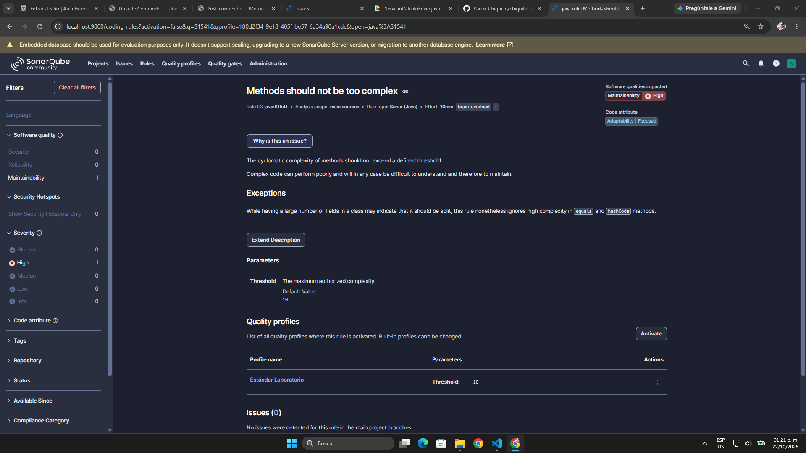
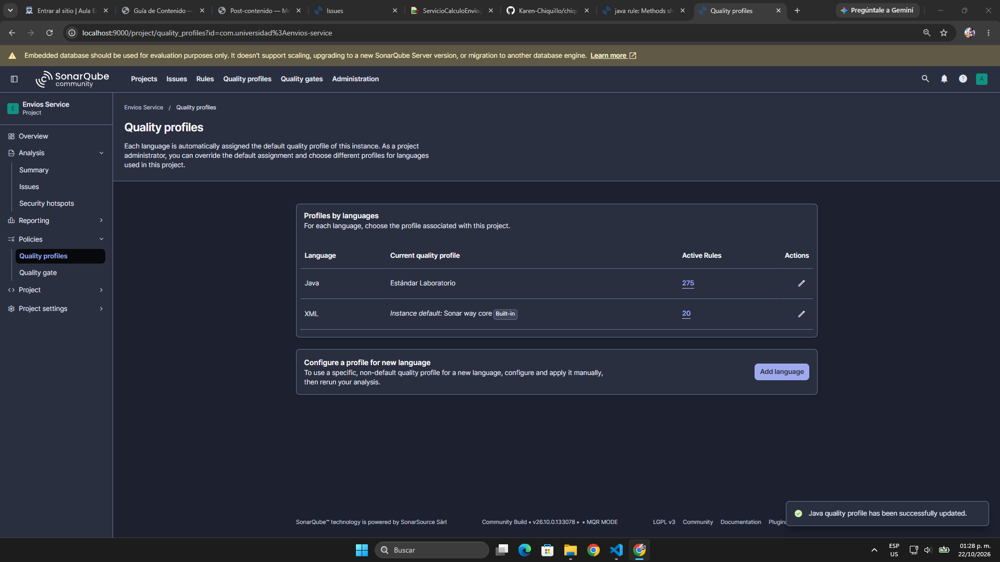
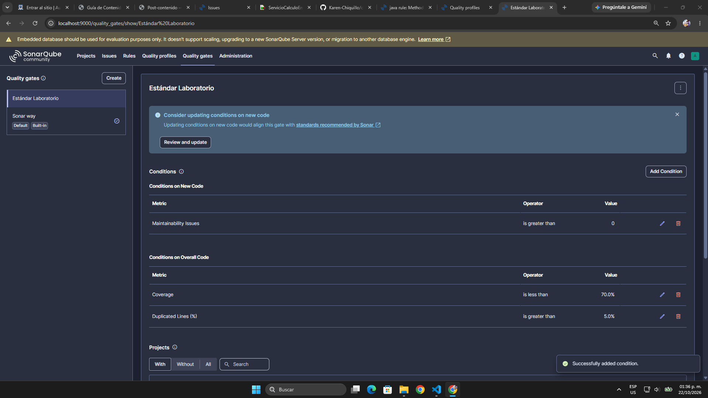
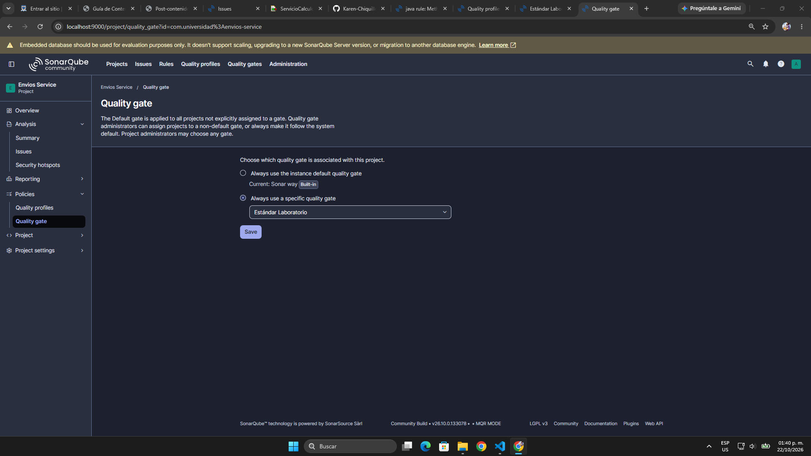

### Decisión de diseño 6 — Realismo del umbral

**¿Por qué CC = 10 por método y no 5 ni 20?**

1. **Es el techo del rango "Moderada" de la Tabla 3.2 de la guía.** Hasta 10 la guía recomienda "monitorear y añadir pruebas", y desde 11 ("Alta") recomienda refactorizar. Con umbral 10, la regla avisa justo en el punto en que la guía dice que hay que actuar. Además, 10 es el valor por defecto que propone la propia regla S1541 (*Default Value: 10*), aunque esa regla no venga activa en "Sonar way".
2. **Con 20 la regla no habría detectado el método de este laboratorio.** S1541 marca los métodos que *superan* el umbral, y `calcularCosto()` tenía CC = 20 exactos. Con un umbral de 20, el método que motivó toda la refactorización habría pasado sin ningún aviso.
3. **Con 5 se castigaría código que ya es razonable.** El orquestador quedó en CC = 5 después del refactor: la selección de la estrategia, la fragilidad y los dos descuentos son reglas que tienen que estar ahí. Un umbral de 5 obligaría a seguir partiendo métodos que todavía se leen y se prueban sin problema, solo para cumplir el número.

**¿Por qué 70% de cobertura y no 100%?**

1. **100% no es realista y produce pruebas vacías.** Como explica la sección 2.3 de la guía, cuando la cobertura se vuelve el objetivo aparecen pruebas sin assertions o de getters y setters que suben el número sin probar nada.
2. **70% es el umbral que la guía usa como ejemplo para JaCoCo (LINE ≥ 0,70)** y deja margen para código de infraestructura o casos difíciles de probar que llegarían si el proyecto crece. Este proyecto queda por encima porque es pura lógica de negocio, pero el gate tiene que servir también cuando no sea así.
3. **No es un umbral regalado.** El "Coverage" de SonarQube combina líneas y ramas, así que es más exigente que el 70% de solo líneas del ejemplo de JaCoCo. Con este gate, el análisis de la Parte 1 (Coverage 21,3%) habría fallado.

**Las otras dos condiciones:** "Maintainability Issues > 0" en código nuevo es estricta, pero es realista porque solo mira el código nuevo o modificado y no obliga a limpiar todo el código viejo de una vez. El 5% de duplicación deja un poco más de margen que el 3% de "Sonar way" para código nuevo, pero igual detectaría si las estrategias volvieran a copiar la lógica de tramos que se centralizó en `TramosDePeso`.

---

## Comparación antes / después

Segundo análisis del 22/10/2026, ya con el perfil y el Quality Gate "Estándar Laboratorio":

| Métrica | Antes (Parte 1) | Después (Parte 2) |
|---------|------------------|--------------------|
| Complejidad ciclomática de calcularCosto() | 20 | **5** (−75%) |
| Cobertura de ramas de la lógica de envío | 18,4% (7 de 38) | **100%** (20 de 20), +81,6 puntos |
| Code Smells (Maintainability issues) | 0 | **0** |
| Quality Gate | — (no existía; con "Sonar way" salió Passed) | **Passed** ("Estándar Laboratorio") |

Otras métricas del mismo análisis:

| Métrica | Antes | Después |
|---------|-------|---------|
| Complejidad cognitiva de `ServicioCalculoEnvio.java` | 32 | 4 |
| Cobertura de líneas | 23,8% (10 de 42) | 100% (37 de 37) |
| Coverage (líneas + ramas, SonarQube) | 21,3% | 100% |
| Duplicaciones | 0,0% | 0,0% (sobre 202 líneas) |
| Complejidad ciclomática total de `src/main` | 20 | 17 (5 en `service` + 12 en `estrategia`) |
| Líneas de código | 128 | 160 |
| Pruebas | 2 | 28 |

**Cómo se lee la comparación:**

- **La meta de complejidad se cumple con margen.** `calcularCosto()` bajó de 20 a 5 (la guía pedía al menos 50%), y la complejidad cognitiva del archivo bajó de 32 a 4, que confirma que el método no solo tiene menos caminos sino que también se lee más fácil. Las estrategias quedaron en 2 cada una y `TramosDePeso` en 4. Ningún método pasa de 5, así que la regla S1541 (umbral 10) no tuvo nada que reportar. Antes, con CC = 20, la misma regla habría marcado `calcularCosto()`.
- **La complejidad total no desapareció, se repartió.** El código principal pasó de 20 a 17 en total y de 128 a 160 líneas. La mejora no es que haya "menos lógica", sino que ya no está toda en un método: cada fórmula se puede leer, probar y cambiar por separado. El costo fue pasar de 1 clase a 7 archivos en `src/main`.
- **SonarQube y JaCoCo cuentan un poco distinto, pero coinciden.** SonarQube da 2 por estrategia y 4 a `TramosDePeso`, y JaCoCo da 3 por estrategia y 3 a `cargoAdicional`. La diferencia es de constructores: JaCoCo suma el constructor implícito de cada estrategia y SonarQube no, y SonarQube cuenta el constructor privado de `TramosDePeso`, que JaCoCo filtra. En `calcularCosto()` los dos dicen 5.
- **La cobertura de ramas se compara sobre toda la lógica de envío.** Antes las 38 ramas estaban en una clase; ahora las 20 ramas están repartidas entre `service` (8) y `estrategia` (12). Bajó el número de ramas porque los tramos de peso se cuentan una sola vez en `TramosDePeso` y la selección del método se hace con el `Map`.

**Resultado del Quality Gate: Passed.** Las tres condiciones se cumplen: 0 Maintainability Issues en código nuevo (límite 0), Coverage 100% (mínimo 70%) y duplicación 0,0% (máximo 5%). En el dashboard aparecen los textos "Required ≥ 70.0%" y "Required ≤ 5.0%" debajo de Coverage y Duplications, que son las condiciones de "Estándar Laboratorio" y no las de "Sonar way". Que pase con 100% de cobertura no quiere decir que el umbral sea muy flojo: este proyecto es pequeño y solo tiene lógica de negocio. El mismo gate habría fallado con el código de la Parte 1 (Coverage 21,3%).

| Antes (Parte 1) | Después (Parte 2) |
|---|---|
|  | 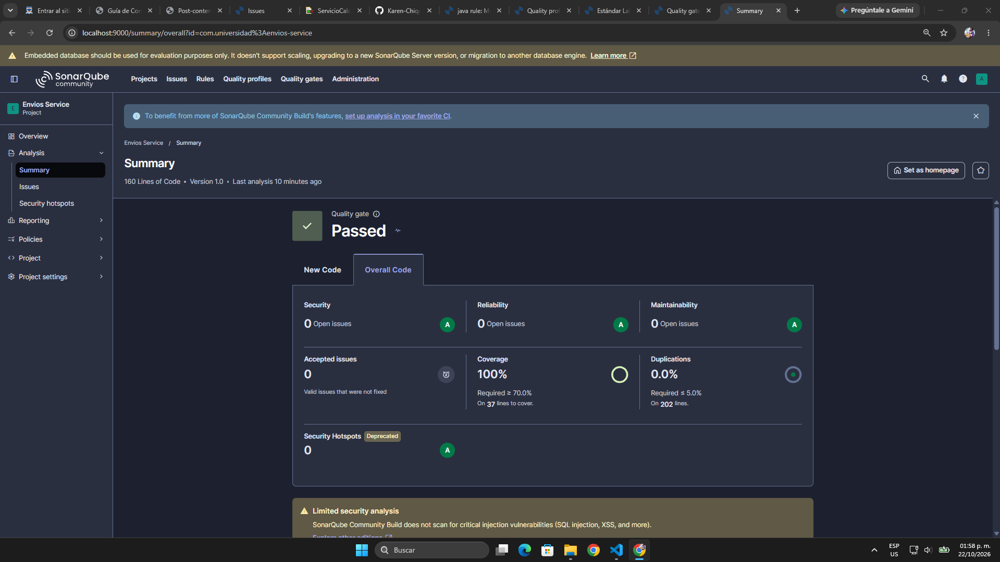 |
|  | 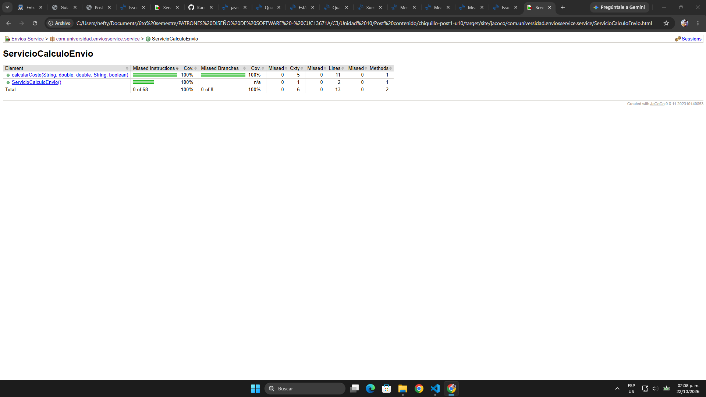 |

## Capturas del análisis final

**Pruebas ejecutadas** — `Tests run: 28, Failures: 0` antes del análisis:

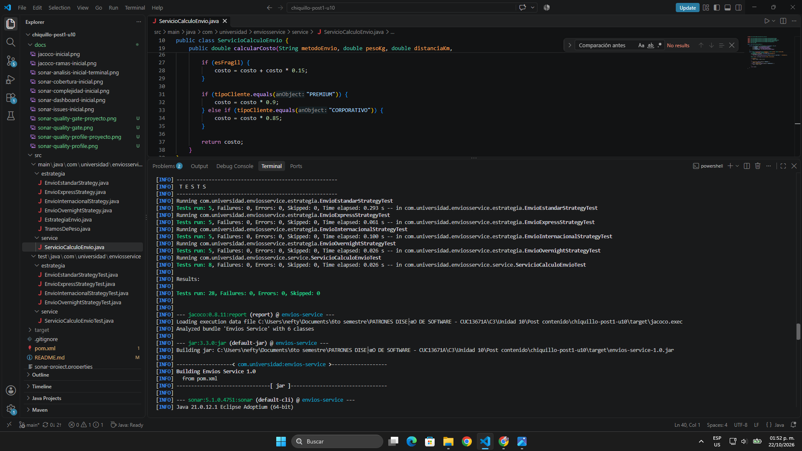

**Análisis ejecutado** — `ANALYSIS SUCCESSFUL` y `BUILD SUCCESS`:

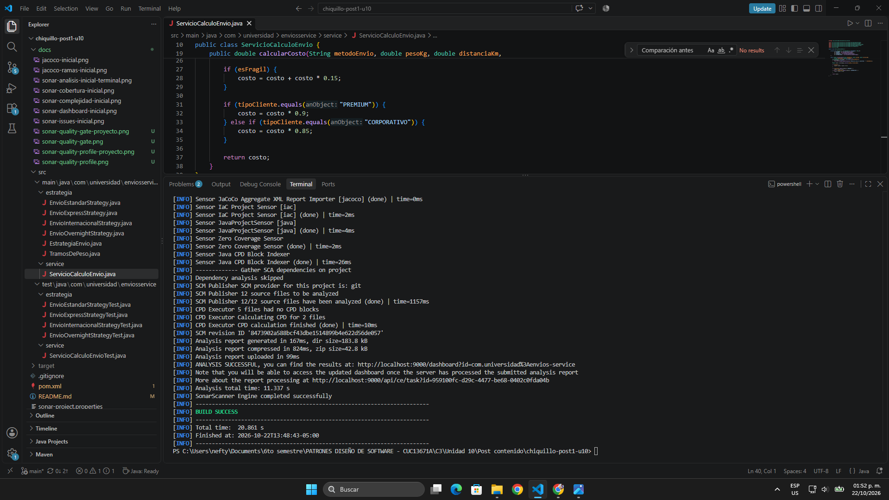

**Dashboard de SonarQube** — Quality Gate Passed, Coverage 100%, 0 issues y duplicación 0,0%:


**Measures → Complexity (`service`)** — `ServicioCalculoEnvio.java` con Cyclomatic Complexity 5 y Cognitive Complexity 4:

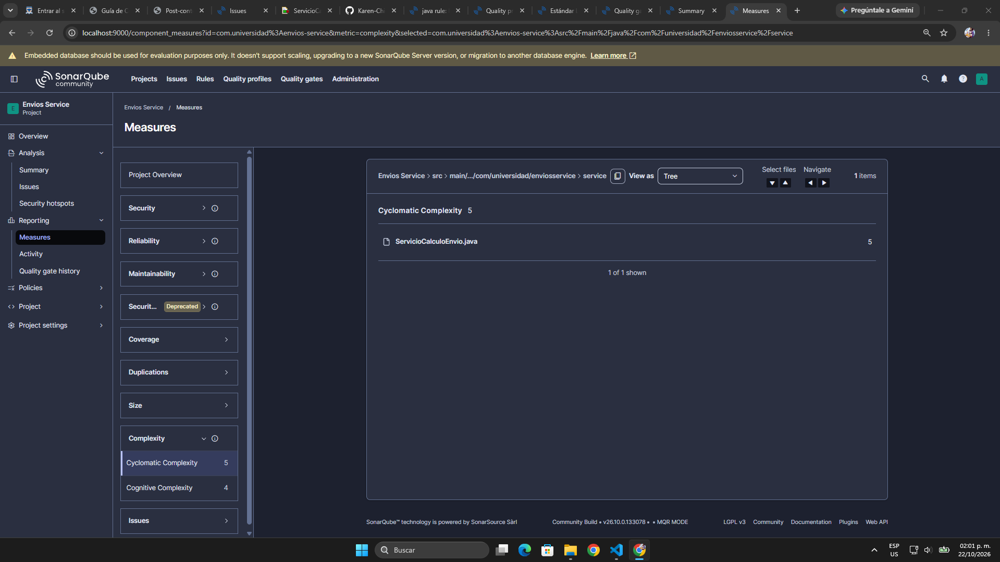

**Measures → Complexity (`estrategia`)** — 2 por estrategia, 4 en `TramosDePeso` y 0 en la interfaz:

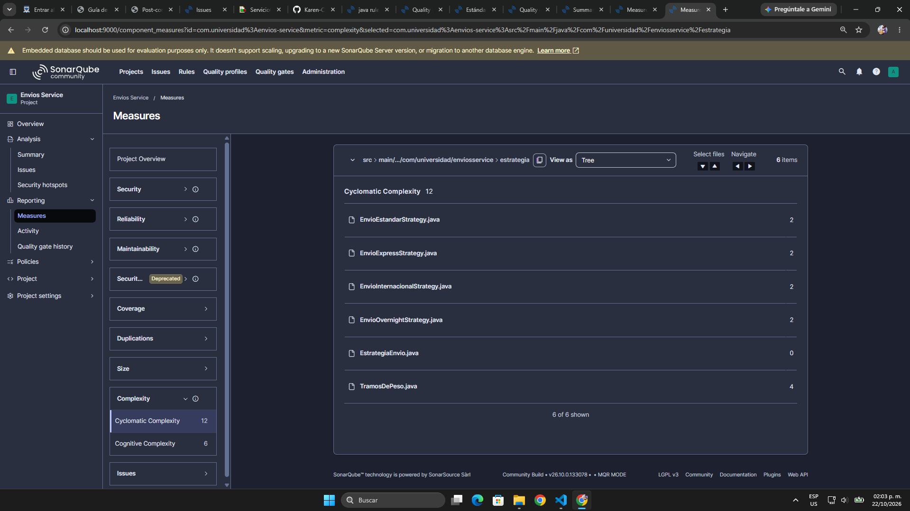

**Measures → Coverage** — Condition Coverage 100% en `estrategia` y en `service`, 0 condiciones sin cubrir:

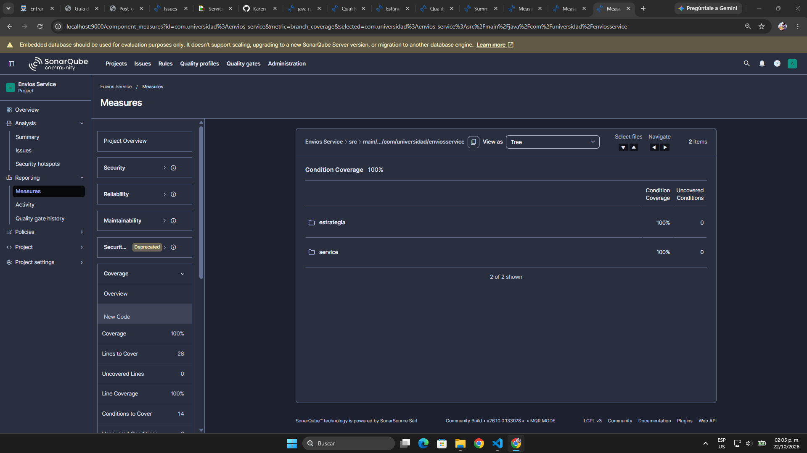

**Issues** — 0 issues con el perfil "Estándar Laboratorio":

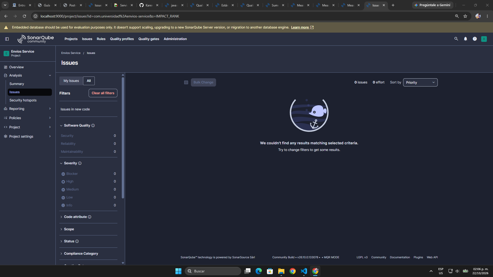

**Reporte JaCoCo del servicio** — `calcularCosto`: Cxty 5 y 8 de 8 ramas cubiertas:


**Reporte JaCoCo del paquete `estrategia`** — las 5 clases al 100% de instrucciones y ramas:

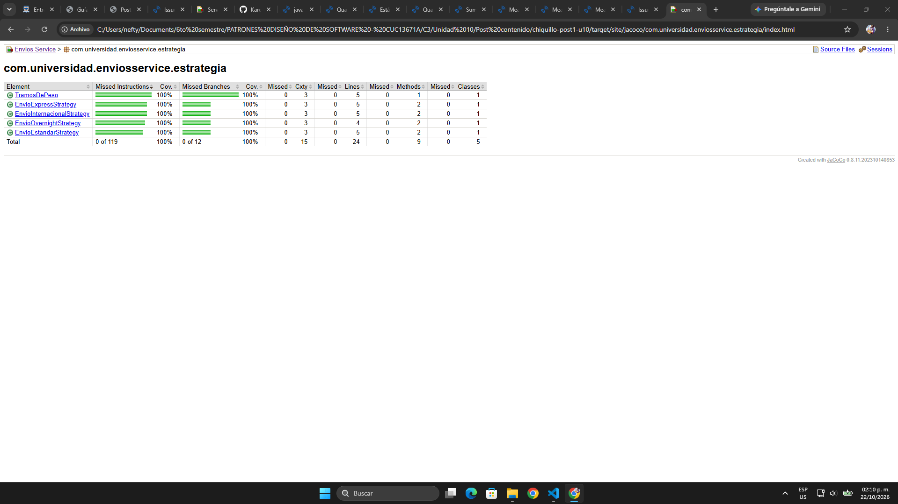

## Herramientas utilizadas

- Java 21, Apache Maven 3.9
- SonarQube Community Build (Docker), JaCoCo 0.8.11
- JUnit 5 (pruebas parametrizadas con `@ParameterizedTest` y `@CsvSource`)
- Git, GitHub

## Conclusiones

En la Parte 1, El diagnóstico dejó claro que el problema está concentrado en `calcularCosto()`, con complejidad ciclomática 20 y solo 7 de 38 ramas cubiertas, y que la cobertura de ramas refleja mejor ese vacío que la de líneas. Además, con la configuración por defecto SonarQube no reportó ningún code smell y el Quality Gate salió "Passed", lo que muestra que hay que leer las métricas y no solo el conteo de issues, y que las reglas y el Quality Gate deben configurarse según lo que se quiere controlar.
En la Parte 2, revisar primero qué tipo de condicionales tenía el método fue lo que llevó a Strategy: las ramas eran fórmulas independientes elegidas por un valor, sin estado ni orden. Con eso la complejidad de `calcularCosto()` bajó de 20 a 5 y la cobertura de ramas subió de 18,4% a 100%, con pruebas dirigidas a las ramas y a los valores límite que antes no se probaban. También quedó claro que la complejidad no se elimina sino que se reparte en clases más pequeñas, y que copiar la guía tal cual habría dejado lógica duplicada y una prueba con un valor esperado equivocado.
En general, el ciclo diagnosticar → refactorizar → volver a medir mostró que las métricas sirven cuando se leen en conjunto y se comparan con datos reales. Un número solo, como un Quality Gate en "Passed" o una cobertura alta, no dice mucho si no se sabe qué está midiendo y con qué reglas.
